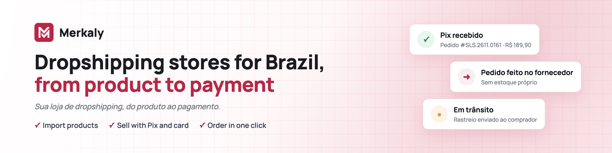
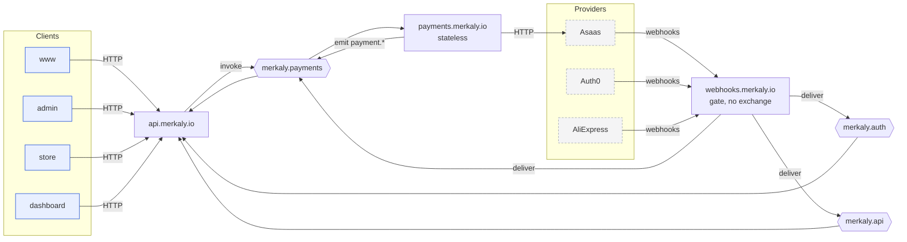
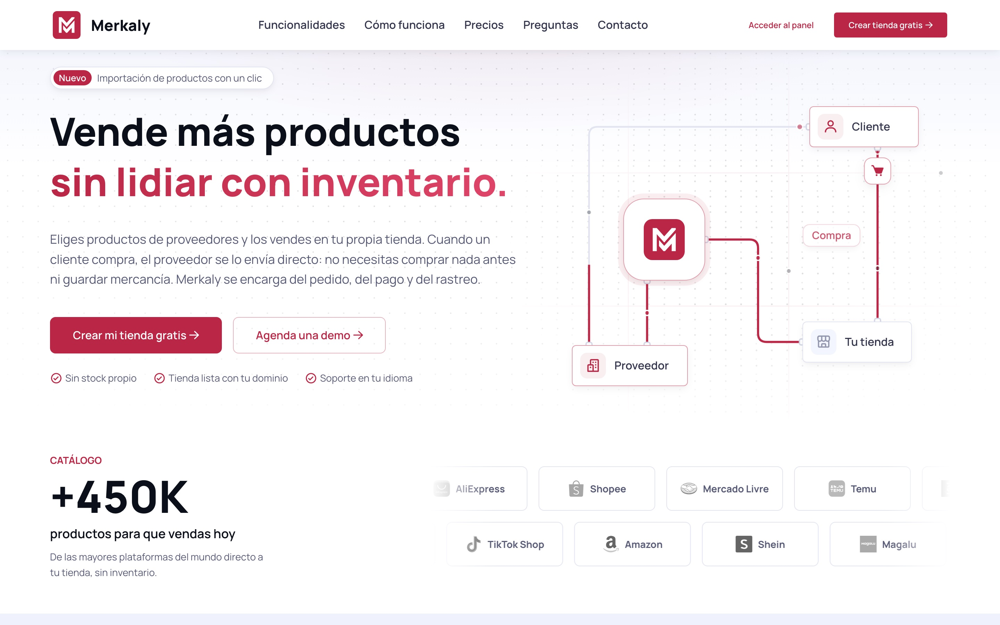
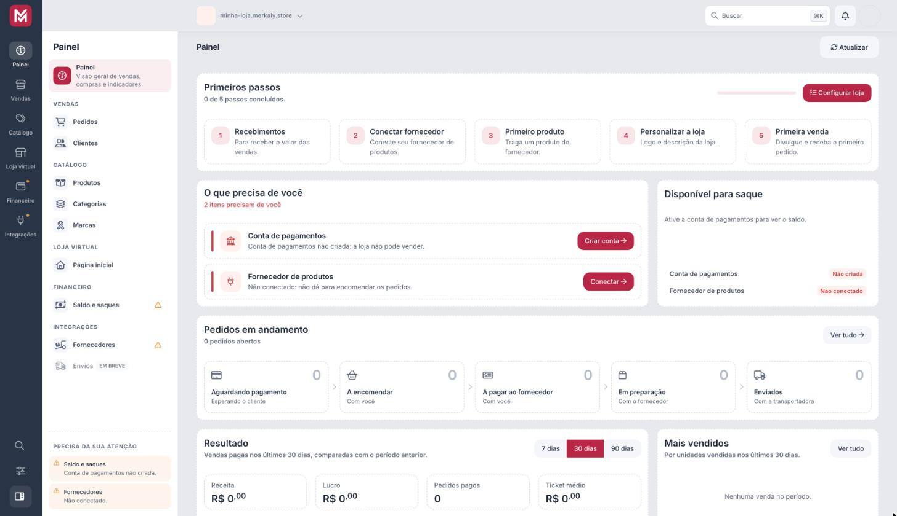
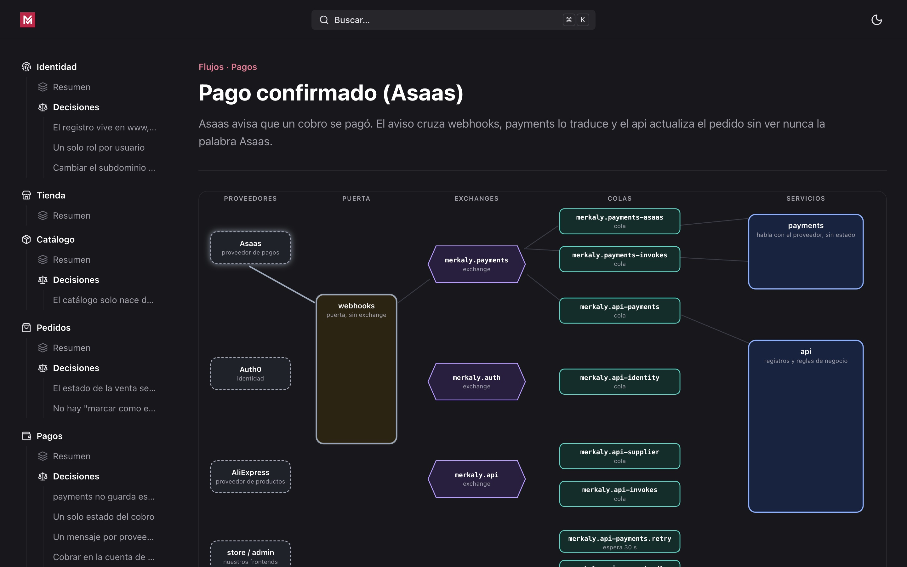

  

  <a href="https://www.merkaly.io">Website</a> ·
  <a href="https://docs.merkaly.io">Docs</a> ·
  <a href="https://docs.merkaly.io/llms.txt">llms.txt</a> ·
  <a href="https://www.linkedin.com/company/merkaly.io">LinkedIn</a>

**Merkaly** lets anyone open a dropshipping store for Brazil: import products from a supplier, sell on your own store with Pix and card, and let Merkaly place the supplier order and track it to the buyer.

How it works, domain by domain (identity, store, catalog, orders, payments, suppliers, platform), with entity maps, animated flows and state machines: **[docs.merkaly.io](https://docs.merkaly.io)**.

## Architecture

- One RabbitMQ topic exchange per domain (`merkaly.<service>`); queues `merkaly.<service>-<work>` with `.retry` and `.dlq`; request-reply on `merkaly.<service>-invokes`.
- `webhooks` is the only door for external providers: it validates and delivers each message into the owner's exchange.
- `payments` is the only service that talks to the payment provider and keeps no state; the `api` keeps the records and the business rules.
- A MongoDB database per tenant (store), Auth0 organizations per store.

See the [messaging flows](https://docs.merkaly.io/flujos) animated step by step.

## What it looks like

| Website | Merchant admin | Docs |
| --- | --- | --- |
|  |  |  |

## Repositories

| Repo | What | Stack |
| --- | --- | --- |
| api.merkaly.io | Records and business rules: catalog, orders, finance, accounts | NestJS, MongoDB |
| payments.merkaly.io | Payment provider integration, invokes on `merkaly.payments` | NestJS |
| webhooks.merkaly.io | Entry gate for providers | NestJS |
| signals.merkaly.io | Notifications (email) | NestJS |
| auth.merkaly.io | Auth0 tenant as code | Auth0 Actions |
| www, admin, store, dashboard | Frontends | Nuxt 4, Vue 3, bootstrap-vue-next |
| [docs.merkaly.io](https://github.com/merkaly-io/docs.merkaly.io) | Documentation site | Docus, Nuxt Content |

Public packages:

| Package | What |
| --- | --- |
| [`@merkaly/api`](https://github.com/merkaly-io/api)  | Shared contracts (entities, enums, validators) synced from the api |
| [`@merkaly/nest`](https://github.com/merkaly-io/nest)  | NestJS base: RabbitMQ (`emit`, `deliver`, `command`, `invoke`), logger, filters |
| [`@merkaly/nuxt`](https://github.com/merkaly-io/nuxt)  | Nuxt module: auth, `$api`, adapters, shared UI |

## Working here

- Conventional commits, small and grouped by logic; PR titles in English, descriptions in Spanish.
- Every PR has a **Docs** section: business rules live in [docs.merkaly.io](https://docs.merkaly.io), and a change there ships with the PR.
- Releases are by tag (`vX.Y.Z`); nobody pushes to `master`.
- Hosting on Railway.

## Contact

- Support: [support@merkaly.io](mailto:support@merkaly.io)
- Sales: [sales@merkaly.io](mailto:sales@merkaly.io)
