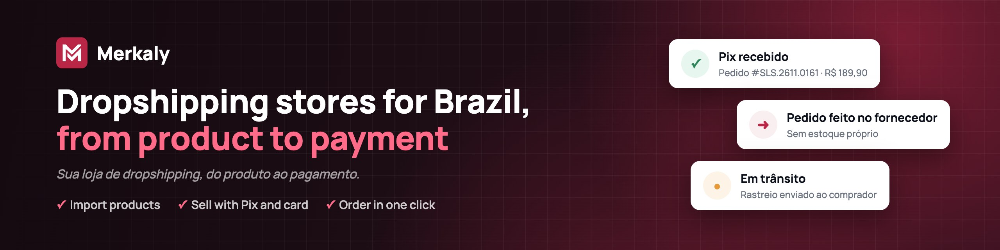
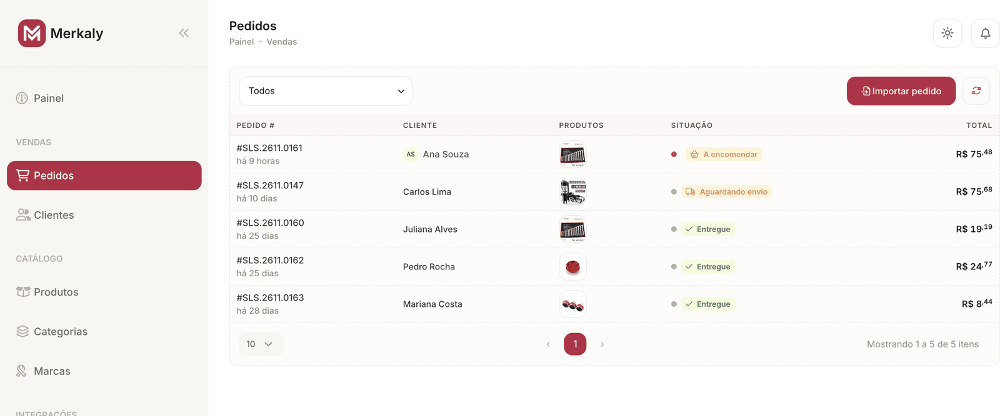

  

  <strong>Merkaly is a dropshipping platform for online stores in Brazil.</strong> 
  <em>Sua loja de dropshipping, do produto ao pagamento.</em>

  <a href="https://www.merkaly.io">Website</a> ·
  <a href="https://www.linkedin.com/company/merkaly.io">LinkedIn</a> ·
  <a href="mailto:support@merkaly.io">support@merkaly.io</a>

## What Merkaly does

- **Import products** from international suppliers with their photos, variants and cost, then set your margin.
- **Sell in your own store** on your own domain, built for the Brazilian market (pt-BR, BRL).
- **Get paid with Pix and card**, with no percentage taken from your sales.
- **Order from the supplier in one click** using the buyer's data; tracking reaches the buyer automatically.
- **Run everything from one control tower**: each order shows its status from payment to delivery, real cost, profit and the next action.

No inventory and no spreadsheets. Monthly plans: Starter (R$ 49), Profissional (R$ 99) and Enterprise (custom).

  

## How it works

1. **Import.** Pick products from a supplier and bring them into your catalog with photos, variants and cost.
2. **Sell.** Your storefront is live on your domain and the buyer pays with Pix or card.
3. **Order in one click.** Merkaly places the supplier order with the buyer's data and keeps you and the buyer posted until delivery.

## Surfaces

| Surface | What it is |
| --- | --- |
| [www.merkaly.io](https://www.merkaly.io) | Marketing site |
| [admin.merkaly.io](https://admin.merkaly.io) | Merchant admin, the control tower |
| Storefronts | Each merchant's own store, on their own domain |
| API | The backend behind all of the above |

## Stack

- **Frontends:** Nuxt 4, Vue 3, Bootstrap 5 ([bootstrap-vue-next](https://bootstrap-vue-next.github.io/bootstrap-vue-next/))
- **Backend:** NestJS and MongoDB, with a database per tenant
- **Identity:** Auth0
- **Events:** RabbitMQ
- **Hosting:** Railway
- **Packages:** `@merkaly/api` (shared contracts), `@merkaly/nuxt`, `@merkaly/nest`

## Contact

- Support: [support@merkaly.io](mailto:support@merkaly.io)
- Sales: [sales@merkaly.io](mailto:sales@merkaly.io)
